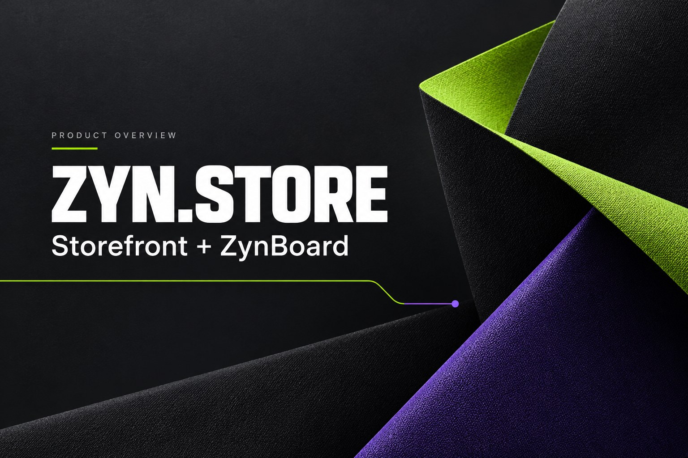
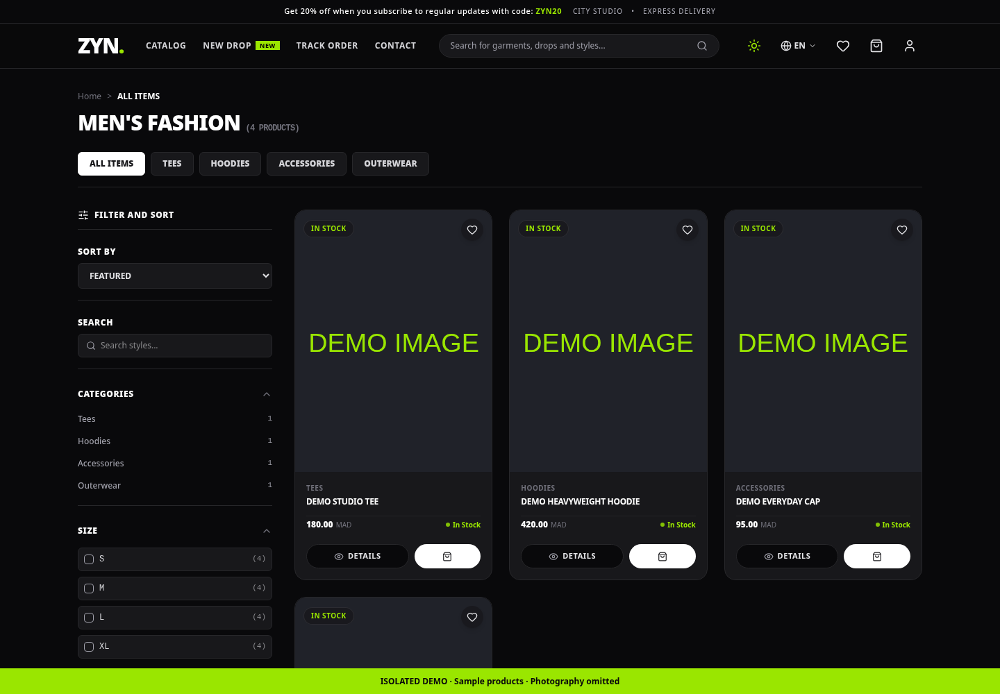
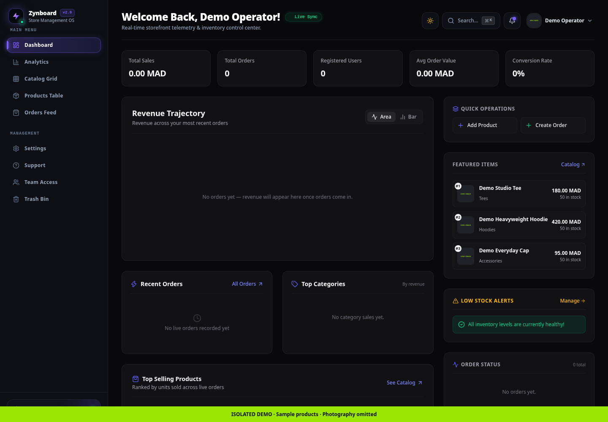

# ZYN.STORE + ZynBoard

An apparel storefront and its connected store management dashboard. ZYN.STORE is for shoppers browsing and ordering clothing. ZynBoard is for authorized operators managing the same catalog and orders.

[Open the store](https://store.zynoks.com) · [Operator dashboard](https://eboard.zynoks.com) · [Support](mailto:contact@zynoks.com)

This is the public product and support repository for both websites. Application source code stays in separate private repositories. This repository does not install or host either application.

## What you can do

**ZYN.STORE**

- Browse categories, search products, filter by size and price, and sort listings.
- View product details, select available sizes and colors, and manage a cart and favorites.
- Check out with cash on delivery, or bank transfer when configured by the operator. Prices are shown in Moroccan dirhams (MAD).
- Use account and address screens, and look up order status.
- Switch between English, French and Arabic, including right-to-left layout, and light or dark appearance. Some text remains in English.

**ZynBoard**

- Create, edit and delete products in the connected catalog.
- View orders and update their fulfillment status.
- View order-based revenue summaries, category totals and charts.
- Search orders and export the displayed order list to CSV.

These capabilities were checked against the current implementation. Public page rendering was checked separately. No real purchase, payment, account creation or production dashboard write was performed during this review.

## See the product

*Actual storefront interface captured in an isolated browser with intercepted API responses. Product names, prices and availability are demonstration data. Third-party photography is omitted.*

*Actual dashboard interface with a synthetic local session and intercepted API responses. Charts and totals are demo values. No production account was accessed. Status indicators and version text visible in the UI are interface labels, not verified service or release claims.*

The cover is AI-generated abstract promotional artwork, not an application screenshot. See [image provenance and prompts](assets/README.md).

## Availability and installation

| Delivery format | Status |
| --- | --- |
| Hosted storefront | Public page available at [store.zynoks.com](https://store.zynoks.com) |
| Hosted dashboard | Page available at [eboard.zynoks.com](https://eboard.zynoks.com); real use requires an authorized operator account |
| Android, iOS, Windows, Linux and macOS installers | No verified distributable packages found; no download is offered here |

Use the websites in a browser. There is nothing to download from this repository. See the [access and installation guide](docs/installation.md). Desktop Chromium page rendering was checked; mobile layouts exist in the implementation, but a complete browser and device compatibility matrix has not been verified. Native apps, app-store availability and offline operation are not established.

## Get started

1. Open the [catalog](https://store.zynoks.com/catalog).
2. Choose an item, review its options and add it to your cart.
3. Review checkout details, delivery charges and the payment choices currently shown by the store.
4. Save your order reference privately. Use the [tracking page](https://store.zynoks.com/track-order) or your account to check progress.

Operators should obtain an account through the store owner, then open ZynBoard. Public screenshots do not provide dashboard access. See the [getting-started guide](docs/getting-started.md).

## Updates, backups and removal

Website updates are managed by the operator. Reload the page to load an update; there is no installer or public update feed to configure.

A CSV export is an order list, not a complete backup. Browser-local settings and trash are not a server backup. Read [backup and restore](docs/backup-and-restore.md) before clearing browser data or deleting products.

To stop using the product, sign out and close its tabs. Clearing site data removes browser-local information, including cart, favorites and local dashboard preferences; it does not delete server-side orders or an account. Contact contact@zynoks.com for account or data requests.

## Current limitations

- Dashboard manual orders currently remain in memory; a success message does not establish a saved server order.
- Dashboard store details, coupon entries, notification preferences and settings-team entries are browser-local. They do not establish live checkout rules, email delivery or real operator accounts. Team Access is an unfinished interface.
- Product trash is a browser-local record. Restore recreates a product; it is not a complete recovery of its original identity or order relationships.
- Stock quantity is represented by a display value derived from availability. Exact inventory counts and low-stock alerts are not verified stock accounting.
- Analytics summarize recorded orders, including statuses that may be unpaid or canceled. Registered users are not measured site visitors; the displayed conversion ratio is not a traffic analytics metric. Some percentage changes are placeholders.
- Dashboard support tickets are simulated. The storefront contact form does not establish email delivery. For support use contact@zynoks.com.
- Bank transfer availability depends on operator configuration. Card payments, automatic payment confirmation, carrier integrations, discount enforcement and email receipts are not verified.
- Marketing text on the websites does not establish delivery times, return terms, discounts or service guarantees. Confirm applicable terms with the operator before ordering.

See [FAQ](docs/faq.md), [troubleshooting](docs/troubleshooting.md) and [release status](CHANGELOG.md).

## Support and rights

Use GitHub Issues for non-sensitive bugs and suggestions once Issues is enabled. Do not post passwords, payment receipts, order references, private notes, customer records or unredacted screenshots. Send sensitive reports privately to **contact@zynoks.com**. Mail delivery has not been tested as part of this review.

No open-source license for the private application is granted here. See [rights and credits](RIGHTS.md) and [third-party notices](THIRD_PARTY_NOTICES.md).
